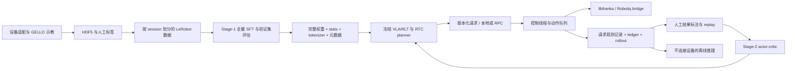

> Historical integration notes. Current hardware, v2 data contract and session commands: [README](../README.md). Current validation: [VALIDATION](VALIDATION.md).

# 4090 整合版：代码边界、文件职责与无运动验证

本次源码以 `/home/heinrich/pi05-rlt-rtc-physical-20261029-review` 及其中的 `stage1_integration` 为基础，整合到 **`/home/heinrich/pi05-rlt-rtc-integrated-20261029`**。原数采、原控制目录、OpenPI 服务及原桥接服务保留。新项目的默认 socket 为 `/tmp/pi05-rlt-rtc-integrated.sock`，与原服务分离。

**历史证据更正：用户明确说明最近的真机运行是直接给动作的尝试，不是合格的模型推理验收。** 旧日志只能作为动作/通信试验材料；不能据此宣称 π0.5、RLT、RTC 或任务成功率已验证。现有 DROID 基础权重也不是本任务 Stage-1 的 RLT 训练结果。

## 当前实现

模型规划和实时执行分离：观测在请求产生时固定，后台 planner 使用完整 H 步参考，控制线程消费既有队列。每条请求、结果、actor 和 replay 带版本身份。数采、SFT 和推理共享 state9/action8、相机变换、连续窗口规则。部署加载时检查训练元数据、归一化统计、tokenizer、架构和源码来源。



参考 OpenPI 的独立 policy 服务和输入输出 transforms、LeRobot 的数据/设备/异步执行分层、RLinf 的模型与训练 worker，以及 RTC 官方实现。这里继续使用已有的 HTTP/Unix socket 和物理动作契约，没有引入新的消息中间件，也没有改用其他机器人动作语义。

- OpenPI：[项目](https://github.com/Physical-Intelligence/openpi)、[policy 服务](https://github.com/Physical-Intelligence/openpi/blob/main/src/openpi/serving/websocket_policy_server.py)。
- LeRobot：[异步推理](https://huggingface.co/docs/lerobot/async)。
- RLinf：[项目](https://github.com/RLinf/RLinf)，本项目锁定 `c70606f08cdca259b8dec03d4430926b5b8fac9d` 加已保留的 Stage-1 补丁。
- RTC：[官方实现](https://github.com/Physical-Intelligence/real-time-chunking-kinetix)，已有数值实现保留其来源说明。

## 关键文件职责

下表是面向使用者的职责索引。**每个代码文件**的路径、来源、相对于复制基线的状态和模块/符号说明见 [完整逐文件清单](../reports/code_inventory.tsv)。vendor 文件也列入清单；它们是保留的依赖，不是本次重新实现的算法。

| 部分 | 关键文件（项目内路径） | 意义与本次状态 |
|---|---|---|
| 物理契约 | `pi05_rlt_rtc/contracts/physical.py`、`spaces.py` | 15 Hz、state9/action8、关节增量及夹爪宽度、H/C/D 定义；复用 |
| 观测契约 | `pi05_rlt_rtc/contracts/observation.py` | 复制传感器数组；新增设备时钟、帧号等 metadata，避免只剩主机接收时间 |
| 请求与计划 | `pi05_rlt_rtc/contracts/plan.py`、`versioning.py` | 请求 tick、策略/特征版本、previous plan、固定延迟的合法性；复用 |
| 标定配置 | `configs/franka_bridge_panda.example.json`、`stage1_integration/configs/collection.json` | 负载、夹爪、相机和示教配置；仍是未验收模板，未猜测缺失参数 |
| 设备驱动 | `pi05_rlt_rtc/adapters/camera_devices.py`、`cameras_panda.py`、`cameras.py` | Kinect/D405 获取与 RGB224 处理；补 metadata 向运行时传递 |
| 控制适配 | `pi05_rlt_rtc/adapters/franka.py` | state/claim/command/stop 协议；补命令发送、ACK 接收时间和桥接回包记录 |
| 底层控制 | `cpp/franka_bridge/bridge.cpp`、`core.hpp`、`robotiq_gripper.cpp` | 有界命令、看门狗、Ruckig、libfranka 与夹爪执行；复用，仅新编译 mock-only 分支做本次验证 |
| 示教采集 | `stage1_integration/pi05_demo/collect.py`、`transport.py` | GELLO/相机/反馈采集和人工结束标签；复用，统一启动入口 |
| 原始记录 | `stage1_integration/pi05_demo/episode.py`、`timing.py` | HDF5 完整性、动作反馈对应、时序审计；复用 |
| 数据检查/导出 | `stage1_integration/pi05_demo/review.py`、`export.py` | 审阅、session 隔离、LeRobot 导出、仅 train 统计；复用 |
| 共同窗口 | `pi05_rlt_rtc/data/windows.py` | 排除跨 episode、缺帧、时间漂移、干预及不完整尾部；复用 |
| 数据 loader | `pi05_rlt_rtc/data/physical_sft.py`、`stage1_integration/pi05_demo/training_data.py` | 两个数据入口共享窗口与 mock 隔离；复用 |
| Stage-1 变换 | `stage1_integration/stage1/data.py` | FP32 quantile、9 维状态先 tokenize 再 pad32、双视角加 masked 第三视角；复用 |
| Stage-1 训练 | `stage1_integration/stage1/worker.py`、`config.py`、`launch.py` | 双卡 FULL_SHARD、完整 SFT、梯度检查点、导出；补 tokenizer 哈希元数据 |
| Stage-1 导出检查 | `stage1_integration/stage1/checkpoint.py` | CPU/meta 严格核对全模型张量；复用，不等于 GPU 前向验证 |
| Stage-1 验证集 | `stage1_integration/stage1/evaluate.py` | **新增**独立 held-out flow MSE（32 维及真实 8 维）与 RLT reconstruction loss；禁用训练图像增强，不报告任务成功率 |
| 本地 tokenizer | `pi05_rlt_rtc/adapters/tokenizer.py` | **新增**只加载训练导出的 SentencePiece 文件，拒绝静默截断；不隐式下载 tokenizer |
| 训练/推理 profile | `pi05_rlt_rtc/adapters/panda_policy.py` | Panda 输入输出与 OpenPI normalize；补训练 tokenizer、horizon、token length 注入 |
| 模型资产入口 | `pi05_rlt_rtc/deployment/model_loader.py` | 严格全权重加载、冻结 VLA/RLT、actor 对齐；接入训练资产校验及源码快照锁 |
| 资产与打包 | `pi05_rlt_rtc/deployment/assets.py` | **新增**无设备 preflight、stats/tokenizer/架构/源码验证、原子导出和 bundle 校验 |
| RLinf 快照锁 | `stage1_integration/vendor/rlinf_stage1/pi05_source_lock.json` | **新增**整个使用中源码树的哈希；避免无 Git 快照不能加载，或源码变化后静默接受 |
| 上游元数据 | `stage1_integration/reports/rlinf_stage1_upstream.json` | 从 4090 恢复的来源记录；Stage-1 导出补丁指纹时需要 |
| 特征/参考适配 | `pi05_rlt_rtc/adapters/rlinf_feature.py` | 只算一次前缀，得到 RLT feature 和完整 H 步参考；复用 |
| RTC 数值 | `pi05_rlt_rtc/rtc/full_vjp.py`、`approx.py`、`canonical.py`、`dispatcher.py`、`prefix_weights.py` | 完整 VJP、近似引导、时间参数转换和模式分发；复用 |
| 规划器 | `pi05_rlt_rtc/deployment/planner.py` | 相同 `[D:D+C]` 后缀语义、actor/teacher、采样当时的学习状态；复用 |
| 队列与执行 | `pi05_rlt_rtc/runtime/queue.py`、`controller.py`、`ledger.py`、`scheduler.py` | 单控制线程拥有 tick/队列，拒绝过期计划；接入请求记录器并在记录失败时停止 trial |
| 请求记录器 | `pi05_rlt_rtc/runtime/recording.py` | **新增**有界后台写入、RGB 无损保存、完整 seed/prefix/previous context；溢出/磁盘失败不静默丢记录 |
| RPC | `pi05_rlt_rtc/deployment/rpc.py`、`tools/planner_server.py` | lossless RGB、metadata 握手、版本身份校验；补传感器 metadata 透传 |
| 离线模型入口 | `pi05_rlt_rtc/deployment/offline.py` | **新增**精确请求回放、从示教 HDF5 单帧推理；完全不构造机器人/相机对象 |
| 运行入口 | `pi05_rlt_rtc/deployment/runtime.py` | trial 管理、停止和日志；smoke/profile 改为读取文件，移除其中的环境 reset |
| 标注与 replay | `pi05_rlt_rtc/deployment/rollout.py`、`learning/transition_assembler.py`、`replay.py` | 人工终止奖励、实际执行 K、故障与干预排除；复用 |
| Stage-2 | `pi05_rlt_rtc/learning/actor.py`、`critic.py`、`losses.py`、`planning_state.py`、`deployment/training.py` | 队列感知 actor-critic、BC warmup、离线及并行 learner；复用 |
| 策略持久化 | `pi05_rlt_rtc/learning/checkpoint.py`、`serialization.py` | actor/critic/优化器与 replay 保存、哈希及恢复；复用 |
| CLI | `pi05_rlt_rtc/tools/cli.py` | 新增 preflight/infer-recording/infer-demo/bundle-runtime/verify-bundle；非 toy Stage-1 smoke 接到现有双卡 launcher |
| 统一脚本 | `scripts/runtime.sh`、`data_pipeline.sh`、`evaluate_stage1.sh`、`start_stage1_integrated.sh` | 显式选择模型/数据/训练解释器；整合目录中旧 wrapper 也重定向到这些入口 |
| 验证脚本 | `scripts/validate_no_motion.py`、`generate_test_dataset.py`、`audit_model_transforms.py`、`verify_stage1_windows.py` | CPU 全链检查、synthetic 数据生成、真实 OpenPI 变换与连续窗口一致性 |
| 新增行为测试 | `tests/test_offline_lifecycle.py`、`test_deployment_assets.py`、`test_stage1_heldout.py` | 文件回放、硬件路径不可达、记录失败停止、资产拒绝、bundle 搬迁及篡改检测、held-out 聚合 |
| 真实数值小模型测试 | `stage1_integration/tests/stage1/test_inference.py` | 真实上游层但随机小参数：三种 RTC、重复性、冻结梯度、验证损失、tokenizer 一致性；明确不代表真机 policy |

## 无运动入口

以下从新项目根目录运行。4090 的 `.venv-validation` 是本次新建、继承现有 OpenPI 环境只读依赖的验证环境；缺少的依赖只安装到新环境。它不是重新部署后的完整独立训练环境。现有数据栈是 Python 3.12 / LeRobot 0.4.4，模型栈是现有 OpenPI 的 Python 3.11；通过导出的文件契约交接，不混用解释器的 site-packages。

```bash
# 不读设备，只验证配置和模型资产。
bash scripts/runtime.sh preflight --runtime-config configs/runtime_franka.yaml --out reports/preflight.json

# 独立数据入口；--help 不启动采集。
PI05_DATA_PYTHON=/home/heinrich/pi05-rlt-rtc-physical-20261029-review/.venv-check/bin/python \
  bash scripts/data_pipeline.sh collect --help

# 训练配置检查；真正全量 SFT 仍使用准备好的双 A800/80GB 训练机。
PI05_TRAIN_PYTHON=/home/heinrich/pi05_plug_demo/.venv-stage1-check/bin/python \
  bash scripts/start_stage1_integrated.sh inspect
```

准备好**真实完整 Stage-1 导出**并填写 `model.checkpoint` 与 `model.norm_stats` 后：

```bash
# 历史示教单帧的冷推理。只读取文件，不执行示教动作。
bash scripts/runtime.sh infer-demo --runtime-config configs/runtime_franka.yaml \
  --episode /absolute/path/episode.h5 --frame 0 --out /absolute/path/new-offline-result

# 对新增请求记录精确重放。要求原策略/特征版本匹配，不偷偷替换模型。
bash scripts/runtime.sh infer-recording --runtime-config configs/runtime_franka.yaml \
  --recording /absolute/path/trial/observations --out /absolute/path/new-replay-result

# 只评估 validation split；统计与 manifest 必须等于训练导出。
PI05_EVAL_PYTHON=/path/to/compatible/model-and-data/python \
  bash scripts/evaluate_stage1.sh --runtime-config configs/runtime_franka.yaml \
  --dataset-root /absolute/path/lerobot-export --max-batches 100 --out /absolute/path/heldout.json

# 新建可搬运的部署包；不覆盖已有目录，不启动服务。
bash scripts/runtime.sh bundle-runtime --runtime-config configs/runtime_franka.yaml --out /absolute/path/new-bundle
bash scripts/runtime.sh verify-bundle /absolute/path/new-bundle
```

验证环境的旧 LeRobot 0.1.0 元数据有既有依赖冲突，因此**不作为 held-out 的完整模型+数据环境来宣称验收**；独立数据入口和模型入口已分别执行。完整大模型 held-out 仍需训练环境/部署环境及真实权重。部署包包含代码和模型资产，不会凭空包含 CUDA 驱动、相机 SDK、硬件标定、训练数据或 Python 虚拟环境。

`infer-recording` 保留请求原来的时间、RNG、pending prefix 和 previous plan，输出 `plans.npz` 与 `report.json`。它只重放规划输入，不将离线输出伪装成之后实际观测。首条冷时延单列，其余才计算分位数；一次单帧推理不能证明 15 Hz 实时预算。报告不包含传感器、RPC 和执行器时延，不能替代现场测量。

`observations/` 只记录每个规划请求及 warm start 的观测，不是全帧视频录像；连续控制 tick 的执行历史仍由 ledger、hardware_commands 和 rollout 记录。设备 source_clock 与主机接收时间分别保存；没有宣称不同设备时钟已经同步到曝光时刻。

## 复现本次验证

```bash
python3 scripts/validate_no_motion.py \
  --data-python /home/heinrich/pi05-rlt-rtc-physical-20261029-review/.venv-check/bin/python \
  --model-python .venv-validation/bin/python \
  --bridge build/mock/pi05_franka_bridge \
  --out reports/a-new-validation-directory
```

脚本要求 bridge 的 CMake 配置为 `PI05_WITH_FRANKA=OFF`。所有 C++ 协议测试只创建临时 socket 并启动独立 `--mock` 进程；不会连接原来的 robot socket。CUDA 对子进程不可见，JAX 限定 CPU。日志与机器可读结果位于 `reports/no_motion_verified/`。

## 仍须由真实资产或现场提供的内容

| 项目 | 当前情况 | 所需动作 |
|---|---|---|
| 真实示教训练集及 train-only stats | 已有 pipeline，不能把 synthetic fixture 当训练数据 | 采集、人工审阅、按 session 划分并导出 |
| 完整 Stage-1 权重 | 本次范围内未找到合格的本任务 RLT 完整训练结果；配置保持 null | 双卡训练并导出 full_weights、训练配置、manifest、stats、tokenizer 和元数据 |
| Stage-2 actor/replay | 代码已有，未找到合格的本任务训练产物 | teacher rollout 经过人工标签后训练；先用 teacher 时不需要 actor |
| 硬件参数 | D405 序列号、负载/惯量、夹爪串口/端点等仍待核验 | 现场填写并检查，不能仅把 hardware_verified 改为 true |
| 真实模型显存/时延 | 原 OpenPI 服务占用约 21 GiB，未加载第二个大模型 | 独立安排资源后执行真实模型文件推理和 profile |
| 真机效果 | 未运行新增真机运动 | 后续单独进行受控 trial；历史直接给动作记录不能作为推理验收 |

本次没有替换旧服务，也没有启动新增真实控制服务。源码锁/文件哈希证明完整性，不证明训练质量；CPU 测试、模型导入成功和 mock bridge 通过也都不是上述资产和现场验收的替代品。

## 本次实际结果

最终完整无运动检查的 9 个检查项全部返回 0，详见 [验证摘要](../reports/remote_verification/no_motion_verified/summary.json)：

| 检查 | 实际结果 |
|---|---|
| 主项目 Python 测试（含新编译 mock bridge 的进程协议测试） | **177 passed / 15 skipped**；跳过项仍需真实数据/大模型/硬件，未伪装成通过 |
| 数采、动作映射、时序和 HDF5 检查 | 21 tests，全部通过 |
| Stage-1 数据、配置和 mock 隔离 | 5 tests，全部通过 |
| 真实上游小模型训练梯度、重计算和权重重载 | 2 tests，全部通过 |
| 三种 RTC 数值模式、held-out loss、tokenizer 一致性 | 2 tests，全部通过；CPU 随机小模型 |
| C++ mock-only 核心测试 | 1/1，通过 |
| 真实 OpenPI 与 Stage-1 数据变换对照 | 32 组 synthetic 输入；状态、动作、token、mask、图像一致 |
| 三个数据 loader 与 Stage-1 worker batch | 连续窗口一致，干预/时间缺口/漂移/缺少时间字段拒绝规则通过；仅 CPU 仿真 rank，不启动分布式训练 |
| 最终资产/回放/标注/模型工厂定向回归 | 17 passed；打包后路径/源码锁格式变化不改变源码内容身份另有定向测试 |
| 真实模型 factory 导入与新 CLI 入口 | 通过，不加载真实权重；完整 Stage-1 配置 inspect 通过 |

原目录 **3381 个参考源码文件的哈希全部未变**；原 OpenPI 服务、真桥接、旧 mock 桥接三者的 PID、命令行与进程启动标识未变。证据见 [保留性检查](../reports/preservation_verification.json)。本次没有发送机器人运动命令，没有停止原服务，也没有将旧动作试验归类成模型推理验收。
